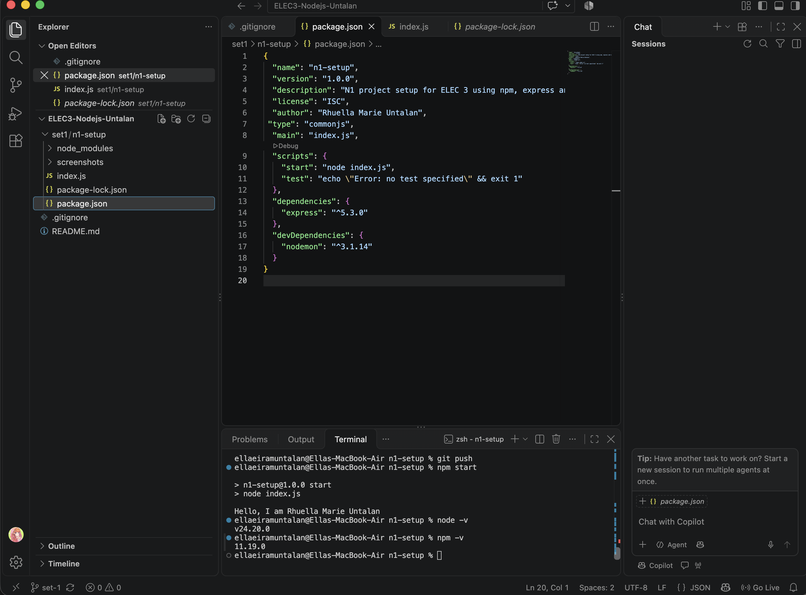

# ELEC 3 – Node.js

**Name:** Rhuella Marie Untalan
**Section:** IV-BSIT A
**Course:** ELEC 3 – Node.js
**Instructor:** Carl Gustaf Patrik B. Ferrer
**Reference:** Node.js Crash Course – Traversy Media

This repository contains my outputs for the ELEC 3 Self-Paced Learning Assignment (lessons from November 9–20, 2026).

---

## Activities

### Set 1 (Nov 23–29, 2026)

| Code | Activity | Description | Folder |
|------|----------|-------------|--------|
| N1 | Project Setup and Package Management | Initializes a Node.js project with `npm init`, installs a regular dependency (`dayjs`) and a dev dependency (`nodemon`), and runs it with `npm start`. | [set1/n1-setup](set1/n1-setup/) |
| N2 | Modular Calculator | Command-line calculator split into custom modules (`operations.js`, `formatter.js`) using `module.exports` and `require()`, with error handling for division by zero and unknown operations. | [set1/n2-calculator](set1/n2-calculator/) |
| N3 | File Manager with fs and path | Creates, reads, updates, deletes, and lists text files in a `files` folder using the `fs` and `path` modules. | [set1/n3-file-manager](set1/n3-file-manager/) |

### Set 2 (Nov 30–Dec 6, 2026)

_To be added after Set 2 is complete._

---

## Requirements

- Node.js and npm (check with `node -v` and `npm -v`)

Clone the repository and go into it:

```bash
git clone https://github.com/Ella-Eiram/ELEC3-Nodejs-Untalan.git
cd ELEC3-Nodejs-Untalan
```

---

## How to Run

### N1 – Project Setup and Package Management

`node_modules` is not included in this repository, so install the packages first:

```bash
cd set1/n1-setup
npm install
npm start
```

For development with automatic restarts, run `npm run dev` (uses nodemon).

Written answers: [N1_answers.pdf](set1/n1-setup/N1_answers.pdf)




### N2 – Modular Calculator

```bash
cd set1/n2-calculator
node index.js <operation> <numbers...>
```

Operations: `add`, `subtract`, `multiply`, `divide`, `average`

Examples:

```bash
node index.js add 12 8          # 12 + 8 = 20
node index.js average 12 8 10   # average of 12, 8, 10 = 10
node index.js divide 12 0       # Error: Cannot divide by zero.
node index.js power 2 3         # Error: Unknown operation "power".
```


### N3 – File Manager with fs and path

```bash
cd set1/n3-file-manager
node index.js <command> [filename] ["content"]
```

| Command | Example | What it does |
|---------|---------|--------------|
| create | `node index.js create notes.txt "Hello"` | Creates a new file with content |
| read | `node index.js read notes.txt` | Displays a file's contents |
| update | `node index.js update notes.txt "More text"` | Appends text to a file |
| delete | `node index.js delete notes.txt` | Deletes a file |
| list | `node index.js list` | Shows every file's full path, name, extension, and contents |

All files are stored in the `files` folder.


---

## Repository Structure

```
ELEC3-Nodejs-Untalan/
├── README.md
├── .gitignore
├── set1/
│   ├── n1-setup/
│   │   ├── index.js
│   │   ├── package.json
│   │   ├── package-lock.json
│   │   ├── N1_answers.pdf
│   │   └── screenshots/
│   ├── n2-calculator/
│   │   ├── index.js
│   │   ├── operations.js
│   │   ├── formatter.js
│   │   └── screenshots/
│   └── n3-file-manager/
│       ├── index.js
│       ├── files/
│       └── screenshots/
└── set2/
```
